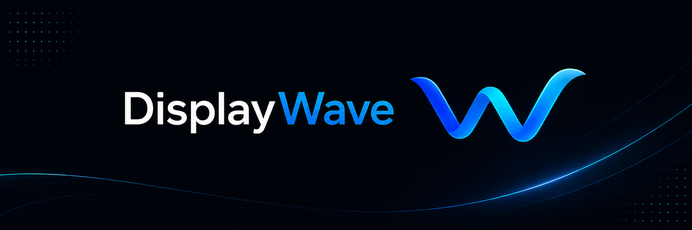
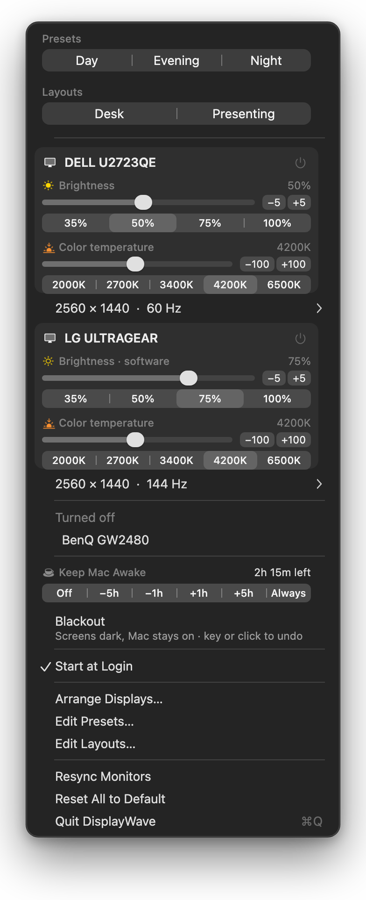
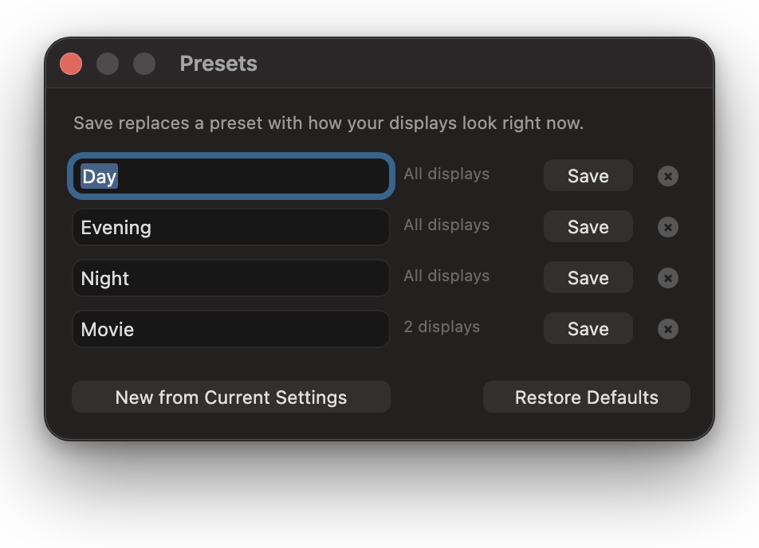
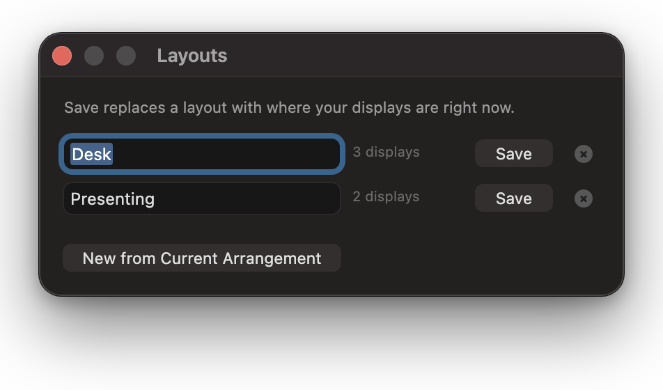

<p align="center">
  
</p>

# DisplayWave

A small, free, open-source menu bar app for external monitors on macOS: turn them
off and on, set brightness and color temperature, switch resolution and refresh
rate, and save it all as presets and layouts.

> If you like this, check out [Warpbin](https://warpbin.com/?ref=github-displaywave), a shared photo gallery for events that I'm also building.

<p align="center">
  
</p>

## Install

Needs a Mac with Apple Silicon and macOS 13 or later.

### Download

1. Download the latest zip from [Releases](https://github.com/kah-ve/DisplayWave/releases)
   and double-click it to unzip.
2. Drag **DisplayWave.app** into your **Applications** folder.
3. Open **Terminal** and run:

   ```bash
   xattr -cr /Applications/DisplayWave.app
   ```

4. Open DisplayWave. A wave icon appears in the menu bar (there's no Dock icon or window).
5. Optional: click **Start at Login** in its menu.

**Why step 3?** The app isn't notarized by Apple (that needs a paid developer
account), so macOS blocks it with *"Apple could not verify DisplayWave is free of
malware"* until the download's quarantine flag is cleared. It's safe to run before
or after that warning appears.

Rather not use Terminal? Try to open the app once, then go to **System Settings →
Privacy & Security** and click **Open Anyway** next to the DisplayWave message.

### Build from source

Building it yourself skips the quarantine step entirely. Needs the Xcode command
line tools (`xcode-select --install`).

```bash
git clone https://github.com/kah-ve/DisplayWave.git
cd DisplayWave
./build.sh
mv DisplayWave.app /Applications/
open /Applications/DisplayWave.app
```

<details>
<summary>Or have an AI coding agent do it</summary>

Paste this into an agent like [Claude Code](https://claude.com/claude-code):

> Clone https://github.com/kah-ve/DisplayWave and set it up on my Mac: build it with
> ./build.sh, move DisplayWave.app into /Applications, and launch it. Install the
> Xcode command line tools first if they're missing. Remind me to click "Start at
> Login" in its menu. Then tell me which of my monitors support hardware backlight
> control and which will use software dimming.

</details>

## Features

- **Turn monitors off and on.** A real disconnect: the monitor loses signal and goes
  to standby. Works on every monitor.
- **Brightness.** Drives the monitor's actual backlight over DDC where the monitor
  supports it, and dims the image on the GPU where it doesn't (the label then reads
  *Brightness · software*). At the bottom of the range both work together, so a
  monitor can go darker than its own minimum.
- **Color temperature** in kelvin, per monitor. 6500K leaves the picture untouched;
  2000K is candlelight.
- **Quick values and nudges** for both: 35–100% and 2000–6500K in one click, plus
  −/+ buttons.
- **Resolution and refresh rate** from a submenu under each monitor.
- **Presets** save brightness and color temperature for every monitor at once.
- **Layouts** save where each monitor sits, which one is main, and its resolution
  and refresh rate.
- **Keep Mac Awake**, for a set number of hours or until you turn it off.
- **Stay Awake with Lid Closed**, for closing the lid before you plug into your
  monitors. Pick 5, 15 or 30 minutes and the Mac stays awake, counting down, until
  a monitor is connected on power (macOS takes over from there) or the time runs
  out; then sleep works as normal again. **Off** ends it straight away. It asks
  for your admin password once, to install a sudoers rule
  (`/etc/sudoers.d/displaywave`) that allows only `pmset -a disablesleep 0` and `1`.
- **Blackout** turns every screen dark while the Mac keeps running, without sleeping
  the displays, so nothing disconnects and no windows move. Any key or click brings
  them back.
- **Start at Login**, from the menu.
- Settings are remembered per monitor and reapplied automatically after sleep,
  replugging, and display changes.

No Dock icon, no background services, no account.

## Presets

Presets sit at the top of the menu. Three come built in and apply to every display:

| Preset | Brightness | Color temperature |
|---|---|---|
| Day | 100% | 6500K (no shift) |
| Evening | 70% | 4200K (warm white) |
| Night | 35% | 2700K (incandescent) |

Set your monitors up how you like, then use **Edit Presets…** to save it as a new
preset or overwrite an existing one. A preset records each monitor separately, and
gives monitors it has never seen the look of the first one it saved.

<p align="center">
  
</p>

## Layouts

Arrange your displays in macOS's settings (**Arrange Displays…** opens them), then
click **Save Current Arrangement** in the menu's *Layouts* row. Clicking a layout
later moves every monitor it knows back into place and restores its resolution and
refresh rate, in one step. Monitors it doesn't know are left alone, and layouts
never turn monitors on or off. **Edit Layouts…** renames, re-saves and deletes them.

<p align="center">
  
</p>

## Troubleshooting

- **A monitor says *Brightness · software*.** It isn't answering DDC. Turn on DDC/CI
  in the monitor's own on-screen menu, or try another cable or port: many docks,
  adapters and some Macs' built-in HDMI ports don't pass DDC through. Then click
  **Resync Monitors**.
- **Something looks wrong after sleep or replugging.** DisplayWave resyncs on its own
  after display changes, sleep and wake, and switching users, but **Resync Monitors**
  forces a full re-check.
- **Reporting a problem.** Run this right after it happens and include the output in
  an issue:

  ```bash
  /usr/bin/log show --last 30m --info --predicate 'subsystem == "local.wave.displaywave"'
  ```

- **Dimming and warmth disappear when the app quits.** That's macOS: it undoes an
  app's gamma changes when the app exits, so DisplayWave has to keep running. (A DDC
  monitor keeps its backlight level.)
- **A display didn't come back.** Turned-off displays are listed under *Turned off*
  in the menu. A restart always brings every display back.

## Alternatives

| App | Great at | Difference |
|---|---|---|
| [MonitorControl](https://github.com/MonitorControl/MonitorControl) | Free, open source; DDC brightness and volume from your keyboard keys, with software dimming as a fallback | No turning monitors off, no color temperature |
| [BetterDisplay](https://github.com/waydabber/BetterDisplay) | Everything: virtual displays, EDID overrides, picture-in-picture | A much bigger app, with many features in the paid Pro tier |
| [Lunar](https://lunar.fyi) | Adaptive brightness that follows ambient light | The adaptive features are paid |
| f.lux / Night Shift | Automatic color temperature by time of day | Same for every display; no brightness or power |
| [DisplayBuddy](https://displaybuddy.app) | Polished presets across many monitors | Paid |

If you want keyboard brightness keys on DDC monitors, use MonitorControl. If you
want virtual displays or EDID overrides, get BetterDisplay. If you want one small
free menu that turns monitors off and dims and warms them whether or not they
support DDC, use this.

## How it works

There are two ways to control a monitor:

- **DDC/CI** sends commands down the video cable asking the monitor to change its
  own settings. It's the only way to really dim the backlight, but it only works if
  the monitor supports it and every cable and adapter in between passes it through.
- **OS-level control** changes what the Mac sends instead. Turning a monitor off uses
  the private `CGSConfigureDisplayEnabled` API, so macOS stops driving the display
  and it goes to standby by itself. Color temperature, and brightness on monitors
  without DDC, adjust the GPU's gamma table.

DisplayWave uses DDC for brightness where it can and gamma everywhere else. Normally
only one of them dims, so the picture isn't doubly dark. Below 25% they stack on
purpose, because many monitors' lowest backlight is still bright in a dark room.
Backlight values are scaled to the maximum the monitor reports and never sent past it.

Color temperature is a real kelvin white point (Tanner Helland's blackbody fit, the
one Redshift uses), normalized so 6500K is no change. Brightness stays a percentage:
DDC's brightness scale has no physical unit, and nothing here can measure nits.

**Probing DDC safely.** A monitor that ignores DDC can block a request inside the
kernel for over a minute, and killing a request midway can knock the display off
the system until it's replugged. So each monitor is probed once on a thread that's
abandoned rather than killed on timeout, the result is cached, and a failed channel
is never retried unless you click **Resync Monitors**. Finding a monitor's DDC
channel walks the I/O registry, which macOS can cut short while displays are
changing, so the walk repeats until it gets a complete pass.

**Blackout** doesn't use display sleep: anything can wake a sleeping display, and
sleep can drop monitors off the bus. Instead it sets gamma to black and, on DDC
monitors, turns the backlight to zero. It doesn't switch panels off over DDC: some
monitors go into standby and won't come back without their power button. The
displays stay awake and connected the whole time. Quitting mid-blackout turns the
backlights back up first; only a force-quit can leave one at zero, and opening
DisplayWave again fixes it.

**Safety.** Turning displays off only lasts for the session, so a restart always
brings every display back. The app won't turn off your last active display, and
brightness never drops below 15% (5% on DDC monitors) so you can always see the
menu. Blackout is the one exception, and any key, click, wake, or quit ends it.

These are private Apple APIs, so DisplayWave can't be on the App Store, and a macOS
update could break them.

## Development

```bash
./build.sh
./DisplayWave.app/Contents/MacOS/DisplayWave --preview out.png
```

`--preview` renders the menu's cards to an image so layout can be checked without
opening the menu. Run the executable inside the bundle: the bare binary uses a
different preferences domain and shows defaults instead of your settings.

`tools/` has small diagnostic programs. Build them from the repo root:

```bash
swiftc -import-objc-header tools/cd.h tools/enum.swift -o tools/enumdisp -framework CoreDisplay           # list displays
swiftc -import-objc-header tools/cd.h tools/modetest.swift -o tools/modetest -framework CoreDisplay       # list and switch modes
swiftc -import-objc-header tools/cd.h tools/gammatest.swift -o tools/gammatest -framework CoreDisplay     # check gamma works
swiftc -import-objc-header tools/probe/ioav.h tools/probe/probe.swift -o tools/probe/probe -framework IOKit  # probe DDC
swiftc tools/awaketest.swift -o tools/awaketest   # keep-awake assertions; quit DisplayWave first
```

If DDC hangs on a port, stop probing it: repeated writes to a stuck channel can drop
the display until it's replugged.

## License

MIT. See [LICENSE](LICENSE).
